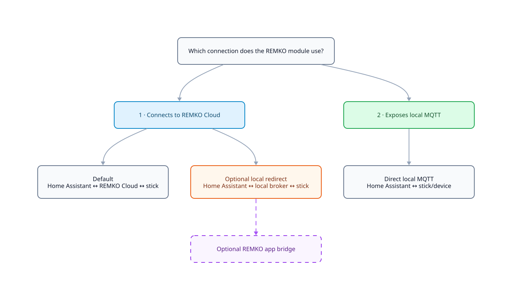

# 🌡️ REMKO SmartWeb — Home Assistant Integration

Control and monitor your REMKO heat pump, air conditioner, or hot water device
from Home Assistant — temperatures, operating modes, switches, and more. The
REMKO Cloud is the default connection; compatible communication modules can
optionally use local MQTT.

> **Not affiliated with REMKO.** This is a community integration and may break if REMKO changes their backend.

---

## 📋 Requirements

- A REMKO device with **SmartWeb** connectivity
- An active **REMKO SmartWeb account** (the same login you use in the REMKO app)

---

## 📦 Installation

**Via HACS (recommended)**

1. HACS → Integrations → ⋮ → **Custom repositories**
2. Add `https://github.com/Christoph-87/remko-smartweb-ha`, category **Integration**
3. Install **REMKO SmartWeb** and restart Home Assistant

**Then add the integration:**

Or go to **Settings → Devices & Services → Add Integration** and search for `REMKO SmartWeb`.

Manual installation

Copy the `custom_components/remko_smartweb/` folder into your Home Assistant config directory and restart.

### 🔄 Updating from 0.4.x

Version 0.5.0 substantially changes the integration's internal communication
architecture and adds optional local MQTT. Existing REMKO Cloud setups were
kept backward-compatible as far as possible. If an existing device regresses,
please [open an issue](https://github.com/Christoph-87/remko-smartweb-ha/issues/new/choose)
with the model, diagnostics, and redacted debug log.

Until a fix is available, HACS users can temporarily return to `v0.4.25` via
**HACS → REMKO SmartWeb → ⋮ → Redownload → v0.4.25**, then restart Home
Assistant. Keep the existing config entry; local MQTT settings introduced in
0.5.x are not available on 0.4.x.

---

## ✅ Supported devices

| Device | Models | Connection path | Status |
|--------|--------|-----------------|:------:|
| ❄️ **Air conditioner** | MXW 204 / 264 / 354 / 524 | REMKO Cloud | ✅ |
| ❄️ **Air conditioner** | SKW 521 DC, RVD 525 DC | REMKO Cloud | ✅ |
| ❄️ **Air conditioner** | RKL 495 DC | REMKO Cloud | ⚠️ |
| ❄️ **Air conditioner** | RKL 355 DC | REMKO Cloud | ⚠️ |
| ❄️ **Air conditioner** | BL 264–354 DC, BL 353 DC | REMKO Cloud | ⚠️ |
| 🚿 **Domestic hot water** | RBW 302 Pro | REMKO Cloud | ✅ |
| 💧 **Dehumidifier** | LTE series | REMKO Cloud | ⚠️ |
| 🌡️ **Compact heat pump** | KWT 180–300 DC | REMKO Cloud | ⚠️ |
| 🔥 **Heat pump** | WKF/WPM systems | Local MQTT on stick/device | ⚠️ |
| 🔥 **Heat pump** | WSP systems | Local MQTT on stick/device | ⚠️ |

✅ Read and write confirmed &nbsp;·&nbsp; ⚠️ At least one direction is experimental
or device-dependent &nbsp;·&nbsp; ❓ Not yet verified

The table shows the confirmed/default connection path. Some cloud devices can
also run locally, depending on their communication module. Models not listed
here may still work and receive a **Diagnostics sensor** for verification.

**Domestic hot water note:** REMKO requires a vacation end date before Vacation mode is activated. Set the `DHW vacation end date` date entity first, then select Vacation mode on the water-heater entity.

---

## 🔌 Connection options

<!-- Generated from docs/diagrams/connection-options.d2 via Kroki; D2's canvas
background rectangle is removed so the SVG remains transparent. -->

REMKO Cloud is the default and needs no local broker or DNS changes. Local MQTT
is optional and experimental; configure one device at a time by following
[Local MQTT setup](docs/local_connection_modes.md).

---

## 🛠️ Troubleshooting

| Problem | What to try |
|---------|-------------|
| No entities after install | Restart Home Assistant |
| Entities unavailable | Check the communication-status sensor and, in cloud mode, internet access |
| Device list is empty or cannot be parsed | Update the integration and restart Home Assistant |
| A command reverts after a few seconds | The device did not confirm it within 30 seconds; collect a debug log |
| Local MQTT does not work | Follow [Local MQTT setup](docs/local_connection_modes.md) and verify broker traffic before testing writes |
| Unknown WKF/WPM register IDs | Use the read-only [WPM register mapping assistant](docs/wpm_register_mapping.md) |
| Commands feel slow | A few seconds of delay is normal on the REMKO Cloud path |
| A control doesn't work | Enable debug logging (see below), try the same action in the REMKO app, then open an issue |

To collect a debug log, open **Settings → Devices & Services → REMKO SmartWeb**,
choose **Enable debug logging**, reproduce the problem, then disable debug
logging to download the log. Remove credentials and personal data before
sharing it.

---

## 🧩 My device isn't supported — can you add it?

The integration can collect diagnostics from unknown SmartWeb devices to help
add support.

1. Add the integration — it creates a **Diagnostics sensor** for unknown devices
2. Enable debug logging and let it run for a few minutes
3. Change **one setting at a time** in the REMKO app and note what and when
4. [Open an issue](https://github.com/Christoph-87/remko-smartweb-ha/issues/new/choose) and include:
   - REMKO model name and device name from the app
   - Diagnostics sensor attributes (`detected_profile`, `portal_type`, `portal_dev`)
   - Relevant lines from the debug log
   - Screenshots from the REMKO app showing available settings

> Remove your email, password, and session IDs before sharing any logs.

---

## 🤝 Contributing

Device reports, redacted logs, documentation fixes, and read-only sensor
mappings are welcome. See the [`CONTRIBUTING.md`](CONTRIBUTING.md) guide for
development setup, testing, device reports, and safe diagnostics.
